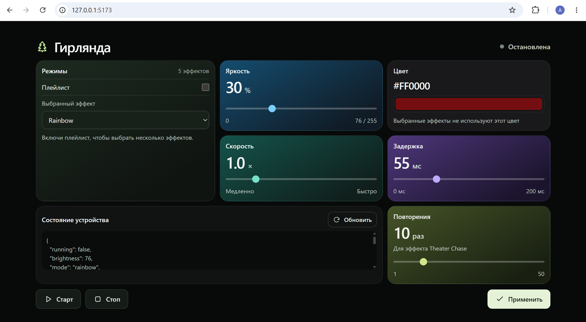

# Гирлянда — панель управления

Учебный проект на React и TypeScript: интерфейс для управления
режимами и настройками светодиодной гирлянды через HTTP API.

Для локального знакомства с приложением в проекте есть тестовый
сервер на Node.js. Он имитирует состояние устройства, поэтому
настоящая гирлянда для запуска не нужна.



## Возможности

- Выбор одного эффекта или нескольких режимов для плейлиста.
- Настройка яркости, цвета, скорости, задержки и числа повторений.
- Запуск и остановка через API.
- Отображение текущего состояния устройства.
- Автоматическое обновление данных раз в секунду.
- Адаптивный интерфейс для компьютера и телефона.

Настройки формы отправляются кнопкой «Применить».
Автоматическое обновление состояния не перезаписывает изменения,
которые пользователь ещё не применил.

## Технологии

React, TypeScript, Vite, CSS.
Тестовый сервер написан на Node.js без дополнительных библиотек.

## Локальный запуск

Для запуска подойдёт Node.js 22 версии 22.12 или выше в этой ветке.

Откройте папку проекта и установи зависимости:

```bash
npm ci
```

В первом терминале запустите тестовый сервер:

```bash
npm run mock
```

Во втором терминале запустите интерфейс:

```bash
npm run dev
```

Откройте адрес, который выведет Vite, обычно:
http://localhost:5173

В PowerShell при ошибке запуска `npm.ps1` используйте `npm.cmd`
вместо `npm`.

Тестовый сервер работает на порту 8000. Vite перенаправляет
к нему запросы `/api`.

## Подключение настоящего устройства

Укажите адрес сервера устройства в ветке `mode === "pi"`
в файле `vite.config.ts`, затем запустите:

```bash
npm run dev:pi
```

Сервер устройства должен поддерживать используемые приложением
маршруты и формат данных.

## API

| Метод | Адрес | Назначение |
| --- | --- | --- |
| GET | `/api/state` | Получить текущее состояние |
| GET | `/api/modes` | Получить список режимов и их возможностей |
| POST | `/api/set` | Изменить выбранные параметры |

Цвет передаётся строкой HEX, например `#ff0000`.
Яркость хранится в диапазоне 0–255 и отображается также в процентах.

## Структура проекта

- `src/App.tsx` — интерфейс, состояние формы и обработчики действий.
- `src/api.ts` — типы данных и HTTP-запросы.
- `src/Icon.tsx` — SVG-иконки.
- `src/App.css` — оформление панели и адаптивная сетка.
- `src/index.css` — общие стили страницы.
- `src/main.tsx` — запуск React-приложения.
- `mock-api.js` — локальный тестовый сервер.
- `vite.config.ts` — настройки Vite, API-прокси и PWA.

## Проверки и сборка

```bash
npm run lint
npm run build
```

## Ограничения

Тестовый сервер хранит состояние в памяти: после его перезапуска
настройки сбрасываются. Он не воспроизводит световые эффекты
и не управляет настоящим устройством.

Для работы собранного интерфейса нужен доступный API.
Прокси из `server.proxy` в Vite используется при разработке.
